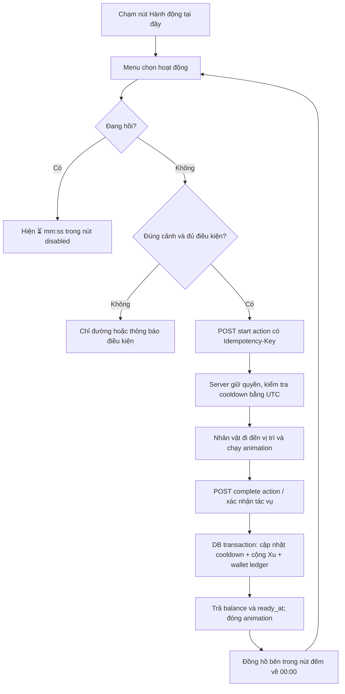
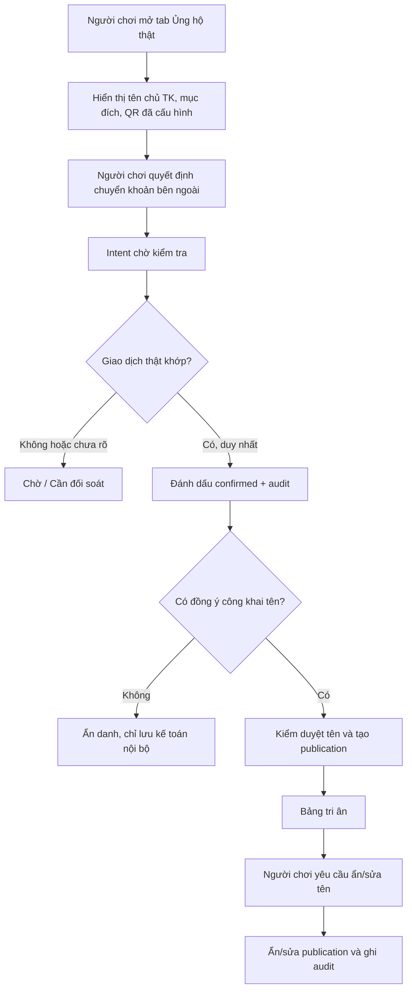

# GIÁO XỨ AN HÒA V3 — ĐẶC TẢ THỰC THI CHO CODEX

**Mục tiêu:** Nâng cấp game 2D hoạt hình toàn màn hình cho Web/mobile, giữ hình nhà thờ phối cảnh sâu đang được duyệt, bỏ hoàn toàn cấp độ, mọi nhiệm vụ đơn giản được thưởng **Xu ảo**; mỗi hành động lặp lại có thời gian hồi 1–10 phút và đồng hồ ngay **trong nút hành động**. Có Hòm ủng hộ, gồm Xu **ảo** đóng góp nâng cấp mô hình nhà thờ và tiền thật **tự nguyện** chuyển cho người vận hành dự án sau khi cấu hình ngân hàng hợp lệ, kiểm chứng giao dịch, quản trị bảng tri ân bằng sự đồng ý của người tham gia.

## I. UX và định hướng thẩm mỹ

- Canvas game 16:9/đầy màn hình, SVG/vector hoặc atlas sprites 2D, chiều sâu qua layer kiến trúc (background, cột, kính màu, nhân vật, ghế, hiệu ứng tiền cảnh), phân lớp nhân vật theo tọa độ `y`; không dùng phối cảnh 3D/WebGL nặng nếu không cần.
- Khung hình chính: góc nhìn trục giữa từ cuối nhà thờ tới cung thánh; cột trắng/vòm cao, bức họa xanh sau thánh giá, hàng ghế gỗ hai bên, lối giữa thoáng. Dựa vào `assets/reference_church_photo.png` và `assets/reference_approved_ui.png`, **không** chèn ảnh chụp làm background (vì nhân vật không tương tác được).
- UI mặc định chỉ hiển thị avatar+tên, số Xu, nơi hiện tại, ô nhiệm vụ đang theo dõi và 6 tab: Bản đồ | Hành động | Nhiệm vụ | Shop | Nhân vật | Khác. Mọi tab là overlay có nút X, chỉ một overlay đang mở. Không hiển thị bảng dài hoặc số lượng icon trên scene.
- Mỗi scene có 1 điểm `🙌 Hành động tại đây`, mở danh sách tối đa 3–7 việc tương ứng. Các điểm đặc thù như ghế, cổng, NPC vẫn chạm riêng. Nút lúc sẵn sàng `Thực hiện +8 Xu`; sau hoàn thành `⏳ 02:59`; disabled tới khi hết thời gian. Mọi nhãn đọc được ở viewport điện thoại 360px.
- Tab `Khác` mở tiếp `Túi đồ`, `Giáng sinh`, `Hòm ủng hộ`, `Cài đặt` — ẩn mặc định để giảm rối.
- Mobile portrait: camera pan-ngang trong world viewport; dock nhỏ ghim dưới safe-area; cửa sổ thành bottom-sheet (scroll nội dung bên trong, không kéo game). Landscape tận dụng full chiều cao.
- Đồ họa nhẹ: giới hạn particles; không chạy canvas ngoài viewport; dùng atlas PNG/WebP 2x và `requestAnimationFrame` cho nhân vật có animation; cache sprites, `prefers-reduced-motion` và chế độ tiết kiệm hiệu ứng. Mục tiêu 60fps desktop, 30/60fps điện thoại tùy máy, không tải thêm ảnh mạng.

## II. Mô hình nhân vật và động tác

### Rig 2D thay đồ
`head`, `hair_front`, `hair_back`, `face`, `torso`, `arm_left_upper`, `arm_left_lower`, `arm_right_upper`, `arm_right_lower`, `leg_left`, `leg_right`, `shoes`, `top`, `bottom`, `accessory`. Mỗi bộ phận có anchor + transform riêng. Cùng skeleton cho Nam/Nữ, đổi dáng/quần-váy và tóc theo mẫu. Áo/giày/váy thay sprite hoặc màu đúng nhóm, không chồng lên body sai layer. Mỗi outfit có item SKU, slot, asset_id, compatibility và giá Xu; **không khóa theo cấp độ**.

### State machine tư thế
`idle ↔ walk` → `sit` / `stand` / `kneel` / `genuflect` / `bow` / `sign_cross` / `pray` / `sweep` / `water` / `wipe` / `carry` / `sing` / `decorate` / `wave`; hành động được thực hiện khi actor đã đến interaction anchor và có line-of-sight/tránh vật cản. Không cho chạy 2 action đồng thời. Một animation 2–4 giây biểu diễn đại diện cho hành động; **thời gian hồi (1–10 phút) là thời gian chờ chứ không phải thời lượng animation**.

- `sign_cross`: tay phải lần lượt chạm trán → ngực → vai trái → vai phải (theo chiều người thực hiện). Một cử chỉ dứt khoát, không lặp vô hạn.
- `bow`: cúi đầu/thân phù hợp khi bày tỏ sự tôn kính; không cho nhân vật leo lên cung thánh.
- `genuflect`: gối **phải** hạ xuống đất (nếu bối cảnh tôn kính Thánh Thể tại Nhà Tạm và điều kiện cho phép). Không đồng nhất việc cúi kính bàn thờ với bái gối trước Nhà Tạm.
- `kneel` / `pray`: quỳ hoặc ngồi thinh lặng trong vị trí ghế cho phép, không chặn lối đi, không ép đối với người có hạn chế vận động.
- `sit`: ghế có 4–6 seat slots; auto-navigate rồi snap vào vị trí ngồi, sprite đổi từ đứng sang ngồi, không có hai nhân vật chiếm một slot.
- `sweep`: cầm chổi, đưa qua lại; `water`: cầm bình, đổ nước; `wipe`: cầm khăn, lau ghế; `sing`: lắc nhẹ, không phát nhạc bản quyền.
- `celebrating_mass`: nếu đang ở chế độ Thánh lễ, chỉ cho các hành động phù hợp, chặn di chuyển vào cung thánh hoặc lao động gây ồn. Thứ tự đứng/ngồi/quỳ theo thời điểm và quy định phụng vụ địa phương; tránh giả lập giáo dân tự xông hương tại bàn thờ.

### NPC chính
Lucia hướng dẫn mở đầu, Ông Giuse đón khách, Cha Minh giải thích nội quy, Sơ Maria dạy giáo lý, Bà Anna trả sách, Bác Phêrô chăm vườn, Chị Hương gói quà, Anh Gioan ca đoàn, Bé An trang trí Noel, Cô Têrêsa cửa hàng. Mỗi NPC có `npc_id, scene_id, spawn, daily_schedule, dialogue_tree, quests, idle_anim, move_radius, interact_radius` và không chặn lối đi, không tự ý thu thông tin xưng tội.

## III. Danh sách hành động lặp lại (bản demo đã có 14 việc)

| Mã | Cảnh | Hành động / animation | Hồi | Xu/lần | Lưu ý |
|---|---|---|---:|---:|---|
| sign_cross | Gian chính | Làm dấu Thánh giá / `cross` | 1:00 | 2 | Minh họa giáo dục |
| bow | Gian chính | Cúi mình / `bow` | 1:30 | 2 | Theo vị trí thích hợp |
| genuflect | Gian chính | Bái gối / `kneel` | 2:00 | 2 | Trong bối cảnh Nhà Tạm |
| quiet | Gian chính | Cầu nguyện thinh lặng / `pray` | 3:00 | 3 | Không biến ân sủng thành điểm |
| prayer | Gian chính | Đọc kinh / `pray` | 4:00 | 4 | Gợi ý kinh cơ bản |
| candle | Góc cầu nguyện gian chính | Thắp nến / `pray` | 5:00 | 4 | Không tùy ý thắp trước bàn thờ |
| pew_clean | Gian chính | Lau ghế / `wipe` | 4:00 | 8 | Chỉ khi không cử hành lễ |
| sweep | Sân | Quét sân / `sweep` | 2:00 | 7 | Có vài vị trí cây lá để tương tác |
| welcome | Tiền sảnh | Đón khách / `wave` | 3:00 | 6 | Hội thoại đơn giản |
| water | Vườn | Tưới hoa / `water` | 3:00 | 8 | Không cần đủ vật phẩm trả phí |
| books | Lớp giáo lý | Sắp xếp sách / `wipe` | 3:00 | 8 | Xếp đúng kệ |
| gifts | Nhà xứ | Chuẩn bị quà / `carry` | 5:00 | 12 | Không trùng tiền thật |
| choir | Phòng ca đoàn | Tập hát / `sing` | 5:00 | 7 | Nhạc gốc hoặc không phát nhạc |
| noel | Quảng trường | Trang trí Noel / `decorate` | 10:00 | 15 | Hiệu ứng trang trí thay đổi theo ngày |

**Chính sách khuyến nghị cho online:** Thưởng Xu là trò chơi, không phải thước đo đức tin; không ép người chơi lặp đi lặp lại tư thế phụng vụ để kiếm nhiều tiền. Với các hành động cầu nguyện, giới hạn số lần nhận Xu/ngày và có thể tặng quà khám phá kiến thức thay vì tăng thưởng theo số lần. Các công việc phục vụ có thể được thưởng Xu tương đối nhiều hơn; số liệu có thể cấu hình qua CMS.

## IV. Luồng interaction và trạng thái

**V3 offline:** làm animation trong trình duyệt rồi cộng Xu trong localStorage, đồng hồ dùng `Date.now()` và lưu `cooldowns[id]` để sau reload vẫn thấy. Đây **không phải** kiểm soát gian lận; người chơi sửa đồng hồ/localStorage được. **Production:** cả cooldown và phần thưởng do backend định đoạt, client chỉ vẽ đồng hồ từ `ready_at` của API và đồng bộ clock offset từ `server_now`.

### Quy tắc transaction quan trọng

1. `POST /actions/{actionId}/start` check game phase, scene, actor, soft-lock, cooldown, limit trong transaction; trả `execution_id`, `complete_after`, `ready_at` và lời thoại.
2. `POST /actions/executions/{executionId}/complete` kiểm tra task hoàn thành hợp lệ, TTL, không duplicate. `SELECT FOR UPDATE` action_state + wallet, cộng Xu atomically và chèn ledger có unique `source_type + source_id`.
3. `GET /me/actions/status` trả toàn bộ cooldown để UI hiển thị ngay khi đăng nhập. Không cho client gửi reward, thời gian hồi hoặc delta tiền.
4. Mất kết nối sau thưởng: retry cùng `idempotency_key`; không cộng hai lần. Bấm nhanh liên tục: giữ nút disabled, backend là nguồn chân lý.
5. Nhiệm vụ chuỗi một lần: `quest_status = available → accepted → completed → claimed`. Nhiệm vụ hằng ngày: reset theo khung giờ của server, `reset_key` và unique nhận thưởng/ngày.
6. Mua đồ: `POST /shop/purchase` dùng transaction trừ Xu, thêm inventory, chèn ledger âm; chỉ loại bình thường/hội hè; không rao bán chức linh mục, bí tích hay ân xá.

## V. Hòm ủng hộ — 2 hệ thống không liên thông

### A. Đóng góp **Xu ảo** trong game

`Khác → Hòm ủng hộ → Xu xây dựng`. Chọn `50 Xu: Chậu hoa`, `150 Xu: Đèn Noel`, `300 Xu: Góc sinh hoạt`. Server trừ wallet, tạo virtual contribution, tăng tiến độ mô hình. **Không** quy đổi Xu thành tiền VND; không đổi tiền VND thành Xu để mua lợi thế. Các milestone có thể mở decor chung cho toàn server, không có đặc quyền thiêng liêng.

### B. Ủng hộ **tiền thật qua QR**

`Khác → Hòm ủng hộ → Ủng hộ thật`:

- Header luôn ghi **“Ủng hộ tự nguyện để phát triển và duy trì trò chơi Giáo Xứ An Hòa”**. Nếu sau này muốn quyên góp cho giáo xứ thật, chỉ thực hiện sau khi xác nhận chủ thể thụ hưởng và được ủy quyền, công khai đơn vị nhận, đích sử dụng, cách quản lý và chứng từ liên quan; không được dùng giao diện để ngầm khẳng định nhà thờ thật đang nhận tiền.
- Admin cấu hình chính xác chủ tài khoản, ngân hàng, số tài khoản, hình VietQR/mã QR động, mô tả nội dung chuyển khoản, cơ chế xác minh; chỉ từ backend. **Không tự bịa QR/số tài khoản.** Desktop hiện QR + `Sao chép tài khoản`, mobile có `Lưu ảnh QR` hoặc `Mở app ngân hàng` nếu tích hợp được.
- `POST /donation-intents` tạo mã `purpose + public_ref`, gắn tài khoản người chơi, tùy chọn tên bảng tri ân và quyền đồng ý công khai. QR có thông tin thụ hưởng và nội dung tham chiếu duy nhất. Trên mobile hiển thị cách lưu mã hoặc copy thông tin.
- Người chơi chuyển khoản trực tiếp trong app ngân hàng. **Việc QR được quét, trang chuyển qua app ngân hàng hoặc người chơi gửi ảnh biên lai đều chưa chứng minh ngân hàng đã nhận tiền.** Nếu có cổng thanh toán/webhook hợp lệ: verify chữ ký webhook, ngân hàng, tiền, mã, giao dịch duy nhất; nếu không có: admin đối soát sao kê thật và xác nhận thủ công.
- `pending → confirmed / needs_review / expired / rejected / refunded`. Chỉ `confirmed` mới được xét ghi tên lên bảng vàng. Không tự hoàn thành dựa trên click client hoặc ảnh chụp, không tự động cộng Xu cho đóng góp thật.
- Khi `confirmed`, chỉ ghi vào `donor_publications` nếu chủ khoản đóng góp opt-in rõ ràng; lưu tên hiển thị (không công khai tên pháp lý, số tài khoản, số tiền hoặc ngân hàng). Có thể chọn **Ẩn danh** mặc định, tên hiển thị cần duyệt chống lạm dụng.
- Bảng tri ân: thay vì “Bảng vàng công đức”, gọi `Bảng tri ân những tấm lòng đồng hành`. Hiển thị avatar biểu tượng, tên được duyệt, một câu cảm ơn; xếp theo thời gian, không xếp hạng số tiền hoặc tạo cạnh tranh tài chính. Người ủng hộ có thể rút lại quyền công khai; admin phải hỗ trợ ẩn tên, xóa hoặc sửa theo quy định dữ liệu cá nhân.
- Trang Admin: `Cấu hình tài khoản nhận`, `Giao dịch chờ đối soát`, `Đã xác nhận`, `Cần xử lý`, `Bảng tri ân công khai`, `Quỹ Xu ảo`, `Audit log`. Roles `SUPERADMIN`, `FINANCE_REVIEWER`, `CONTENT_MODERATOR`; reviewer tài chính xác minh tiền, moderator kiểm duyệt tên, không trộn hai quyền.
- Không ghi chú nội dung riêng tư về xưng tội, bệnh tật, nguyện cầu hoặc tín ngưỡng vào bảng tài trợ. Không đặt hành động donate cạnh nút xưng tội/rửa tội theo kiểu phải đóng tiền mới được tiếp tục.

### Luồng thanh toán/tri ân

**Demo offline V3:** hiện QR **“Chưa cấu hình”** vì user chưa cung cấp tài khoản chủ nhận; phần tạo yêu cầu/duyệt là **DEMO GIẢ LẬP**, hoàn toàn không phát hiện thanh toán. Không được đưa thao tác phê duyệt demo này vào tài khoản người chơi trong production.

## VI. API tối thiểu

| Method/endpoint | Vai trò | Payload/response cốt lõi |
|---|---|---|
| `GET /api/me` | Player | name, gender, appearance, wallet, server_now |
| `GET /api/scenes/:id` | Player | NPCs, object anchors, allowed_actions, occupied_seats |
| `GET /api/actions?scene=id` | Player | label, coin_reward, cooldown_seconds, ready_at |
| `POST /api/actions/:id/start` | Player | idempotency-key; execution_id, complete_after |
| `POST /api/executions/:id/complete` | Player | status, ready_at, balance, ledger_id |
| `GET /api/quests` | Player | status, progress, rewards (Xu) |
| `POST /api/quests/:id/accept` | Player | server-validated accept |
| `POST /api/quests/:id/claim` | Player | unique claim + wallet transaction |
| `POST /api/shop/purchase` | Player | unique purchase + wallet transaction |
| `POST /api/virtual-contributions` | Player | amount Xu, goal_id, result |
| `GET /api/donation-config` | Public | verified beneficiary config, display payment method |
| `POST /api/donation-intents` | Player | unique bank transfer ref, publish_name_opt_in |
| `GET /api/donation-intents/:id` | Owner | payment state, not raw bank secrets |
| `POST /api/payments/webhook` | Gateway only | verify signature, reconcile bank txn, idempotency |
| `POST /api/admin/donations/:id/verify` | Finance admin only | reason, reference, audit |
| `GET /api/donor-wall` | Public | approved display names only |
| `PATCH /api/me/donor-publication/:id` | Donor | revoke / edit name, request moderation |

## VII. Database

Xem `docs/schema_v3.sql`: users, avatars, wallet+immutable ledger, action definitions, action cooldowns+executions, quest progress, inventory, scene seats, virtual contributions, real donation intents, verified transfers, public donor consents/publications, audit events. Postgres UTC timestamptz; riêng thông tin tài khoản nhận được đọc từ cấu hình server. Cần index `(user_id, ready_at)` để API lấy countdown nhanh.

## VIII. Quy định tôn giáo và thực tế

- Game không bao giờ thực sự cử hành bí tích, rước lễ, giải tội hay ban ân xá; mô phỏng kiến thức và animation ở vùng tương thích. Người không theo đạo vẫn được chơi bình đẳng.
- Không dùng động tác quỳ/bái như bắt buộc cho mọi người; người khuyết tật hoặc hạn chế vận động có thể chọn mô tả/hoạt cảnh thay thế.
- Bái gối trước Thánh Thể ở Nhà Tạm khác với cúi mình trước bàn thờ; hương trong Thánh lễ do thừa tác viên phụng vụ thực hiện. Đừng cho mọi nhân vật tự dùng bình hương ở cung thánh.
- Tiền xin lễ, tiền giỏ và tiền trợ giúp phát triển ứng dụng không phải cùng một khoản, cần ghi rõ tên khoản thu và đúng đơn vị thụ hưởng.
- Bảo mật dữ liệu: Luật Bảo vệ dữ liệu cá nhân Việt Nam số 91/2025/QH15 đã có hiệu lực từ 01/01/2026; coi tên hiển thị liên quan đóng góp và dữ liệu giao dịch là thông tin cần quyền đồng ý/mục đích, hạn chế công khai.

## IX. Thứ tự phát triển và nghiệm thu

P0: Không level; 14 action; đồng hồ đếm chính xác và hồi sau reload; nhận Xu một lần; Shop mua trang phục theo Xu; mobile sheet đẹp; no overlapping hotspot.  
P1: Nâng animation 2D rig thật (tay chân khớp chuyển động), navmesh tránh ghế, xếp ghế không đè nhau, NPC schedules, công việc hằng ngày.  
P2: Auth, persistent Postgres, server-authoritative game economy, logs, daily caps, anti-exploit.  
P3: Ủng hộ Xu ảo và cấu hình QR thật + đối soát giao dịch, dashboard admin, consent publication, kiểm thử bảo mật.  
P4: Sự kiện Giáng sinh nhiều chặng, mục tiêu trang trí cộng đồng, cốt truyện và hoạt động mới.

### Bộ test cần pass
1. Mỗi action có `cooldown_seconds ∈ [60,600]`, `coin_reward > 0` và scene hợp lệ.
2. Bấm nhanh hai lần, reload hoặc mở hai tab cùng tài khoản không cộng Xu hai lần.
3. Sau hành động, nút hiện `mm:ss` giảm dần; khi hết hiển thị `Thực hiện +... Xu`.
4. Không thêm biểu tượng dày đặc trên nave, ít nhất 1 cửa sổ không che hết giao diện trong modal desktop.
5. Trang phục Nam/Nữ đổi layer thật, không xuyên tay/chân, không mất quyền sở hữu sau reload.
6. Virtual contributions không tạo record real money; real donation không tự cộng Xu.
7. Không có QR ngân hàng giả; chưa cấu hình thì hiển thị rõ trạng thái thiếu cấu hình.
8. Chỉ webhook đã xác minh hoặc admin đối soát sao kê thật mới xác nhận donation.
9. Không đăng bảng tri ân khi chưa đồng ý; rút lại quyền thì xóa khỏi feed công khai.
10. Không hiển thị tên pháp lý, số tài khoản, số tiền theo mặc định.

## Tài liệu đối chiếu
- Vatican GIRM: cúi mình, bái gối, tư thế trong phụng vụ: https://www.vatican.va/roman_curia/congregations/ccdds/documents/rc_con_ccdds_doc_20030317_ordinamento-messale_en.html
- Catechism, indulgences: https://www.vatican.va/content/catechism/en/part_two/section_two/chapter_two/article_4/x_indulgences.html
- Catechism, simony: https://www.vatican.va/content/catechism/en/part_three/section_two/chapter_one/article_1/iii_you_shall_have_no_other_gods_before_me.html
- NAPAS VietQR: https://www.napas.com.vn/dich-vu-chuyen-tien-nhanh-napas-247
- Bộ Công an, Luật 91/2025/QH15: https://bocongan.gov.vn/chinh-sach-phap-luat/co-so-du-lieu-van-ban/luat-bao-ve-du-lieu-ca-nhan-1753688803
