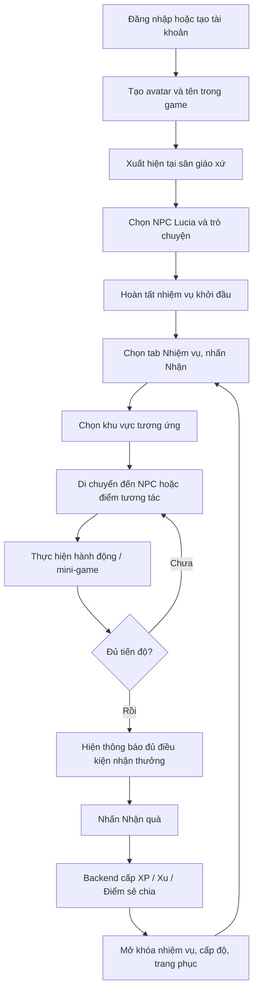

# MASTER SPEC CHO CODEX — GIÁO XỨ AN HÒA (2D PARISH LIFE RPG)

**Phiên bản:** 0.1 — playable vertical slice + lộ trình phát triển 1.0  
**Mục tiêu:** Xây dựng game 2D nhẹ, đẹp, vui, có thể chơi 10–20 phút; người chơi đi lại trong một giáo xứ Công giáo hư cấu, nói chuyện NPC, nhận nhiệm vụ, tương tác đồ vật, tích lũy kinh nghiệm và trang phục.  
**Nguồn tham khảo giao diện thực thi:** `index.html` đi kèm; dữ liệu machine-readable trong `game_content.json`.  
**Định hướng:** Một trò chơi **đời sống giáo xứ**, không phải mô phỏng bí tích như cơ chế đổi điểm.

---

## A. YÊU CẦU ĐỐI VỚI CODEX — CÓ THỂ DÙNG LÀ PROMPT

> Hãy dùng `index.html`, `CODEX_IMPLEMENTATION.md`, `schema.sql` làm nguồn sự thật ban đầu. Nâng cấp game 2D **Giáo Xứ An Hòa**, đảm bảo không mất các tính năng đang chạy. Trước khi thay UI, hãy chạy thử các luồng tạo nhân vật → gặp Lucia → nhận/hoàn thành nhiệm vụ → nhận quà → lên level → mua đồ → mặc đồ → lưu và tải lại. Giữ nguyên cấu trúc logic định danh `scene_id`, `npc_id`, `quest_id`, `event_code`. Tách game thành frontend TypeScript/Vite + Phaser 3 (hoặc PixiJS + pathfinding) và backend Postgres, với giao diện HUD React. Ưu tiên bố cục game 2D 1150×670, kiến trúc Gothic cách điệu, màu ấm, ánh sáng kính màu, nhiều animation 2D; không dùng asset vi phạm bản quyền. Nhiệm vụ/nội dung được tải từ DB và có thể cấu hình bởi admin; XP/Xu/Điểm sẻ chia chỉ cấp bởi backend, có transaction/idempotency, giới hạn hoạt động lặp. Không thu thập nội dung xưng tội/tín ngưỡng riêng tư; không dùng nghi thức Rửa Tội, Hòa Giải, Rước Lễ, Thánh lễ như phần thưởng cày điểm. Đảm bảo thao tác bằng chuột/cảm ứng, mobile responsive, hỗ trợ tiếng Việt dấu đầy đủ. Viết E2E tests và một bản demo triển khai có thể chơi ngay.

**Các tiêu chí tuyệt đối không được bỏ:**
1. 11 bản đồ có thể truy cập, khác biệt rõ về hình ảnh, vật thể và NPC.
2. Tạo nhân vật, di chuyển tới điểm bấm, điều hướng qua cửa, tương tác theo phạm vi.
3. Tab Nhiệm vụ: Chưa mở / Có thể nhận / Đang làm / Đủ điều kiện nhận quà / Đã nhận.
4. Người chơi nhìn thấy NPC, biểu tượng `!` khi có nhiệm vụ, hội thoại lựa chọn, cập nhật nhiệm vụ theo hành động hợp lệ.
5. Tăng XP/level, ví Xu, Điểm sẻ chia, tủ trang phục, mua và mặc, lưu và phục hồi.
6. Các hành động có tính *vật lý trong game* (tưới, nhặt sách, ngồi ghế, trang trí...) đổi trạng thái đồ vật trên bản đồ.
7. Mọi phần việc xưng tội, rửa tội là **giới thiệu, tham quan, bài học**, không phải cử hành bí tích trong game.
8. Nội dung nhạy cảm: không cho người chơi nhập tội đã phạm, không ghi lại lời cầu nguyện, không suy đoán đạo thật của người chơi.

---

## B. GAME LOOP VÀ TIẾN ĐỘ NGƯỜI CHƠI

### B1. Luồng cơ bản



### B2. Tốc độ trải nghiệm

- **0–2 phút:** tạo nhân vật, gặp Lucia, lấy 75 XP + 50 Xu.
- **2–5 phút:** đi xuyên từ sân → tiền sảnh → gian chính, chọn ghế, nhận thêm XP.
- **5–10 phút:** chọn một trong ba nhánh: học giáo lý, chăm sóc vườn, gặp cha xứ.
- **10–20 phút:** mini-game tập nhịp, gói quà, giao sách, trang trí Noel, mua và đổi quần áo.
- **Quay lại ngày sau (bản mở rộng):** nhiệm vụ hằng ngày có giới hạn; NPC di chuyển theo giờ; sự kiện theo mùa.

### B3. Phân biệt 3 tuyến truyện

Người chơi chọn **mục đích trong trò chơi**, không phải khai báo tôn giáo ngoài đời:
- **Khách tham quan:** tìm hiểu không gian nhà thờ, nghệ thuật, lịch sử.
- **Người tìm hiểu giáo lý:** mở thêm các bài học về bí tích, phụng vụ, cộng đoàn.
- **Người thích sinh hoạt cộng đồng:** mở nhanh các hoạt động thiện nguyện, ca đoàn, sự kiện.

Tất cả các tuyến đều có thể khám phá toàn bản đồ. Tuyến truyện là lựa chọn nội dung, **không phải xác nhận thực tế rằng người chơi đã rửa tội**.

---

## C. DESIGN SYSTEM / GIAO DIỆN

### C1. Phong cách mỹ thuật

- **Góc nhìn:** 2D top-down pha 2.5D ở tiền cảnh, tường và đối tượng vẽ nghiêng nhẹ; tránh phối cảnh isometric khiến khó di chuyển hoặc chặn góc nhìn.
- **Kiến trúc:** nhà thờ Gothic cách điệu, hai tháp chuông, mái ngói đỏ, cửa vòm, kính màu xanh lam / hổ phách, cột đá kem, bàn thờ rõ vị trí.
- **Tông màu:** nền navy `#101A2C`, giấy kem `#FFF9EC`, vàng kim `#E4B16A`, xanh ngọc `#70D2AF`, màu gỗ `#9A6A4A`.
- **Độ phân giải scene gốc:** `1150×670`, layer responsive giữ tỷ lệ, vector hoặc tilemap. Có thể nâng lên asset 2300×1340 (2x) cho Retina.
- **Tỷ lệ nhân vật:** 70×100 trong thế giới SVG gốc; NPC khác biệt rõ ở tóc, kiểu áo, dáng, vai trò. Chuẩn spritesheet khi nâng cấp: idle 4 frames, walk 8 mỗi hướng, sit 3, kneel 3, talk 4, interact 4, emote 6.
- **Ánh sáng:** vệt nắng qua kính màu, bóng đổ mềm phía bàn ghế và chân nhân vật; ánh đèn vàng đêm Noel.
- **UI:** bo 10–20px, thẻ nhiệm vụ có trạng thái, chữ Việt rõ, icon có tooltip; tránh nhét quá nhiều tên tương tác trên ảnh ở một lúc.
- **Âm thanh:** bước chân/gió/chuông gió/nhịp tự sáng tác; không dùng bài thánh ca có bản quyền khi chưa được cấp phép.

### C2. Wireframe HUD desktop

```text
┌─────────────────────────────────────────────────────────────────────────────────────┐
│ ⛪ Giáo Xứ An Hòa                 ⭐ Lv.3 [XP █████░░]   🪙 240    💚 90    👤 An Nhiên│
├────────────────┬──────────────────────────────────────────────┬─────────────────────┤
│ BẢN ĐỒ         │ 🌿 SÂN GIÁO XỨ             [Không gian]     │ NHIỆM VỤ | TÚI | SỔ │
│                │                                              │                     │
│ Sân giáo xứ    │       [Cửa nhà thờ]    [Nhà xứ]              │ ◈ Ba luống hoa       │
│ Tiền sảnh      │                                              │   2/3 luống đã tưới │
│ Gian chính     │  NPC Lucia (!)             [Lớp giáo lý]     │   [Đến điểm cần làm]│
│ Rửa Tội        │              ┌───────┐                       │                     │
│ Hòa Giải       │  Vườn hoa   │ Avatar│    Đường đi          │ ◈ Thăm gian chính    │
│ Lớp giáo lý    │              └───────┘                       │   [Nhận nhiệm vụ]   │
│ Ca đoàn        │                                              │                     │
│ Vườn / Nhà xứ  │        [Gian trang phục] [Noel]              │ Hoàn thành → [Quà]  │
│ Quảng trường   │                                              │                     │
├────────────────┴──────────────────────────────────────────────┴─────────────────────┤
│ GỢI Ý: Nói chuyện NPC, chạm vật thể.   [Nhiệm vụ] [Trang phục] [Hướng dẫn]          │
└─────────────────────────────────────────────────────────────────────────────────────┘
```

**Desktop:** trái 230px / giữa co giãn / phải 330px; panel phải cuộn riêng.  
**Tablet:** danh sách địa điểm thành dải ngang.  
**Mobile:** trên là HUD gọn, dưới là bản đồ toàn chiều ngang, nhiệm vụ mở thành drawer; hotspot có vùng chạm ≥44×44 CSS px, tránh label dài.

### C3. Thành phần giao diện tái sử dụng

`GameShell`, `TopHUD`, `MapSidebar`, `SceneViewport`, `InteractionHotspot`, `NPCSprite`, `DialogueModal`, `QuestJournal`, `QuestCard`, `ObjectiveProgress`, `InventoryPanel`, `ShopModal`, `ToastQueue`, `MiniGamePanel`, `AvatarCreator`, `LoadingScene`, `HelpOverlay`, `ScenePortal`.

### C4. Trạng thái nhất quán

- NPC chưa có nhiệm vụ: dấu `💬`; nhiệm vụ có thể nhận: `!` vàng; nhiệm vụ đang chờ trả: `✔` xanh; nhiệm vụ bị khóa: không hiện `!`.
- Bấm một NPC: tính đường A* → avatar đi tới trong phạm vi 1–1.5 tile → quay mặt → mở hội thoại; bấm vị trí khác thì hủy đường đang chạy.
- Bấm một điểm tương tác: nếu đang thực hiện hành động, khóa nút cho tới animation kết thúc.
- Quà nhiệm vụ: thông báo + thay đổi số lượng ví + hiệu ứng ngắn, tránh confetti trong Thánh lễ mô phỏng.
- UI hover/focus mô tả vật thể và biểu thị vùng có thể tương tác.

---

## D. CẤU TRÚC THẾ GIỚI — THIẾT KẾ CHI TIẾT 11 KHU VỰC

**Tọa độ** dùng phần trăm tương ứng với khung 1150×670; `scene_id` phải ổn định khi đổi artwork. Không đưa teleport vào vị trí va chạm với tường, bàn thờ, ghế hoặc NPC.

| ID | Khu vực | Hình ảnh đặc trưng | NPC | Tương tác chính |
|---|---|---|---|---|
| `courtyard` | Sân giáo xứ | Mặt tiền nhà thờ hai tháp chuông, đường lát đá, đài phun nước, nhà quanh sân, cây | Lucia, bác Phêrô | chào NPC, đọc bảng tin, các cửa sang khu khác |
| `foyer` | Tiền sảnh | Cửa lớn chia đôi, hai phòng bên, bảng giờ lễ, bình nước thánh | Ông Giuse | hỏi giờ lễ minh họa, nhận hướng dẫn, cửa vào gian chính |
| `nave` | Gian chính | kính màu, cung thánh, bàn thờ, giảng đài, 2 dãy ghế, lối đi giữa | NPC giáo dân trong giờ giả lập | chọn chỗ ngồi, tìm hiểu bàn thờ/giảng đài/Thánh lễ, vào ca đoàn |
| `confession` | Góc Hòa Giải | cửa gỗ, buồng riêng tư, đèn dịu, ghế chờ | không cần NPC linh mục thường trực | tìm hiểu bí tích, khu suy ngẫm riêng không lưu dữ liệu |
| `baptistry` | Khu giếng Rửa Tội | giếng nước bằng đá, cửa kính màu, giá nến, biểu tượng nước | giáo lý viên ghé theo lịch (Phase 2) | khám phá giếng và trả lời câu hỏi giáo lý |
| `classroom` | Lớp giáo lý | bảng xanh, ghế bàn, tranh/ sách, kệ sách | Sơ Maria | quiz, tìm sách bà Anna, mini lesson |
| `choir` | Phòng ca đoàn | bảng nốt nhạc, bục tập, giá để sách hát | Anh Gioan | chơi nhịp 3–5 bước, luyện tập |
| `garden` | Vườn cộng đồng | 3 luống hoa, bình tưới, ghế đá, lối đi | Bà Anna | tưới đủ 3 luống, trả sách, nói chuyện |
| `office` | Nhà xứ | bàn tiếp khách, bảng lịch, sách, bàn chuẩn bị quà | Cha Minh, chị Hương | đối thoại với cha, gói quà cộng đồng |
| `christmas` | Quảng trường Noel | hang đá, cây thông, đèn dây, sao vàng, sân tuyết trang trí | Bé An | trang trí 3 vị trí, sinh hoạt Noel |
| `shop` | Gian trang phục | quầy gỗ, móc treo, gương và tủ đồ | Cô Têrêsa | mua, thử và trang bị trang phục |

### D1. Sân giáo xứ — `courtyard`

- **Camera:** nhìn xuống sân; nhà thờ ở trục trung tâm phía bắc, đường lát đá dẫn từ cổng đến cửa chính. Bên trái có vườn và lớp giáo lý; bên phải nhà xứ và quảng trường Noel.
- **Các hotspot:** `church→foyer` (x50,y30); `classroom` (18,41); `garden` (16,76); `office` (84,36); `christmas` (84,77); `notice` (67,56).
- **Trật tự trải nghiệm:** NPC Lucia hiển thị `!` ngay khi người chơi mới xuất hiện; lời thoại 2 dòng; quest đầu tiên tự được kích hoạt. Cột bảng tin mở UI sự kiện hằng ngày.
- **Artwork cần nâng cấp:** bóng tháp chuông, chuông báo các khung giờ trong game, lá cây rung nhẹ, bồ câu bay, suối đài phun nước loop 8 frames.
- **Không gian đi bộ:** quanh sân, không bước xuyên tường hay đài phun nước.

### D2. Tiền sảnh — `foyer`

- **Bố cục:** cửa dẫn gian chính ở phía trên, phòng Rửa Tội trái, góc Hòa Giải phải; chân vào từ cửa sân phía dưới. Bình nước thánh và bảng giờ lễ ở hai bên.
- **NPC:** ông Giuse giới thiệu các khu vực, có icon giải thích nếu lần đầu tiếp xúc.
- **Interaction:** chọn cửa: `transition` có fade 250ms; không đứng xuyên vào tường. Bảng giờ lễ chỉ hiển thị lịch **hư cấu** của game.
- **Chi tiết:** cửa vòm cao, gạch đá hoa, tấm thảm ở chân cửa, ánh nắng mờ qua cửa kính.

### D3. Gian chính — `nave`

```text
                 CỬA SỔ KÍNH MÀU / CỘT
 ┌────────────────────────────────────────────────┐
 │ Tượng/tranh     ✝ TƯỢNG CHỊU NẠN     Tượng     │
 │                ┌─ CUNG THÁNH ─┐                │
 │ Giảng đài      │  BÀN THỜ    │   Ghế chủ tế    │
 │                └─────────────┘                │
 │                                                │
 │ [A1] [A1] [A1]  LỐI ĐI  [B1] [B1] [B1]       │
 │ [A2] [A2] [A2]   GIỮA  [B2] [B2] [B2]       │
 │ [A3] [A3] [A3]         [B3] [B3] [B3]       │
 │ [A4] [A4] [A4]         [B4] [B4] [B4]       │
 │      CỬA SANG CA ĐOÀN  |  CỬA TIỀN SẢNH      │
 └────────────────────────────────────────────────┘
```

- **Bắt buộc chia cấu trúc `seat_id`:** `nave.A1.01` đến `nave.A4.06`; `nave.B1.01` đến `nave.B4.06` (48 ghế ngồi game, không nhất thiết tương ứng 48 băng ghế). `row`, `side`, `seat_index`, `pos`, `facing`, `is_accessible`, `occupancy`.
- **Nếu chơi đơn:** không thể ngồi cùng slot với NPC; vị trí khả dụng là slot không có cư dân đang ngồi theo lịch.
- **Nếu multiplayer:** server cấp seat lease cho một scene instance, ghế hết hạn khi người chơi rời phòng/disconnect; không nhận hai người cùng slot.
- **Thao tác ghế:** `Tap seat → navigate → sit animation 0.5s → icon đang ngồi`. Bấm lần nữa: đứng dậy. Có `kneel` dưới dạng tư thế tôn trọng, không thưởng điểm kinh tế.
- **Bàn thờ:** chỉ mở modal tìm hiểu từ gian giáo dân. Avatar người thường không được tự ý đi vào cung thánh.
- **Giảng đài:** mở thẻ thông tin mô tả vai trò đọc Lời Chúa.
- **Thánh lễ mô phỏng:** cinematic có lời giới thiệu, hoạt cảnh đứng/ngồi và nghe; **không có mô phỏng truyền phép như trò mini-game, không cho người chưa đủ điều kiện “rước lễ ảo” để nhận XP**.
- **Lưu ý gameplay:** không phát hiệu ứng chiến thắng ồn ào khi đang trong một phân đoạn Thánh lễ.

### D4. Góc Hòa Giải — `confession`

- Phòng gỗ tông tối và ấm; cửa riêng tư, đèn vàng, chỗ chờ; camera không nhìn vào phía trong nơi xưng tội.
- Hai tương tác: `Tìm hiểu bí tích` (giải thích bằng văn bản) và `Góc yên tĩnh` (không nhập dữ liệu).
- Đừng viết NPC đòi người chơi kể tội hoặc “xá tội” bằng nút. Không ghi âm/nhật ký nội dung xét mình.
- Đánh dấu tiến độ `learn_confession` cho **nhiệm vụ học hỏi**, không đánh dấu đã xưng tội.

### D5. Khu Rửa Tội — `baptistry`

- Giếng nước trung tâm (x52,y45), đá sáng, các tia sáng xanh, giá nến, biểu tượng nước và ánh sáng.
- Click giếng → pop-up giải thích ý nghĩa → event `learn_font`.
- Click câu hỏi → đúng đáp án “Một lần trong đời” → event `baptism_quiz`.
- Hoạt động này **không** đổi trạng thái `is_baptized` trong game và không được in “chứng nhận Rửa Tội”.

### D6. Lớp giáo lý — `classroom`

- Bảng giáo lý và 6 bàn học; Sơ Maria đứng cạnh bảng; kệ sách nằm phía trái.
- Mini-quiz thân thiện, mỗi lượt 1 câu 3 đáp án; có mô tả sau đáp án đúng, không nhục mạ khi sai.
- Có vật phẩm `book_anna` trên kệ. Khi nhặt: kệ sách hiện ngăn trống hoặc icon biến mất; trong túi đồ có biểu tượng cuốn sách; đưa cho bà Anna để hoàn tất.
- Có thể mở rộng quiz 10–20 câu dữ liệu từ DB, biên tập bởi người phụ trách nội dung.

### D7. Phòng ca đoàn — `choir`

- Bảng nốt nhạc, giá nhạc, ghế, nhạc cụ biểu trưng và anh Gioan.
- Minigame demo: lặp đúng `🔔 → 🥁 → 🎵`. Sau này đổi sang mô hình `note_id`/`beat_time_ms` với nhạc ngắn tự tạo.
- Kết quả đúng tăng tiến độ `choir_game`, **chỉ cấp quà khi người chơi đã nhận nhiệm vụ và nhấn nhận thưởng**.
- Không chèn nhạc bản quyền vào dự án nếu chưa được phép sử dụng.

### D8. Vườn cộng đồng — `garden`

- 3 hotspot `plot1`,`plot2`,`plot3`. Click một lần: hiệu ứng tưới (2 giây) → hoa chuyển sang trạng thái tươi → event `water_plot`.
- Bảng nhiệm vụ chỉ đếm **3 luống khác nhau**, không cho cày 3 lần trên cùng một luống.
- Sau khi làm xong, có thể tới bà Anna để trao sách, nhận lời cảm ơn.
- Phần mở rộng: trồng hạt giống, 24 giờ game nảy mầm, dọn rác 1 lần/ngày.

### D9. Nhà xứ — `office`

- Cha Minh gần bàn tiếp khách, chị Hương gần bàn quà. NPC Cha hướng dẫn thắc mắc tín ngưỡng bằng lời thoại ngắn.
- Bàn quà: chọn “Gói quà” → minh họa bỏ khăn, vở, tấm thiệp vào hộp → hoàn tất `pack_gift`.
- Phase 2: chia quà tới cư dân; mini-game sắp xếp hàng hóa theo chỉ dẫn, không mô phỏng quyên góp tiền thật.

### D10. Quảng trường Noel — `christmas`

- Treo dây đèn, cây thông, hang đá, sao vàng; chuyển màu theo thời gian game.
- 3 hotspot riêng `decor1`,`decor2`,`decor3` cần click mỗi nơi một lần; đồ trang trí hiện lên sau khi làm.
- Sự kiện Giáng sinh 2026 trong game có thể kích hoạt khoảng cuối tháng 11 đến cuối tháng 12, do admin cấu hình ngày; không cứng hóa thời gian thật vào client.
- Các mini-game mở rộng: tìm ngôi sao thất lạc, gói quà, chụp ảnh kỷ niệm, tham gia nhóm nhạc; quà là thời trang và trang trí.

### D11. Gian trang phục — `shop`

- Tủ quần áo, gương, NPC cô Têrêsa; danh sách áo theo level và giá.
- Shop chỉ có cosmetic, không có “mua quyền xưng tội”, “mua phép lành”, “mua thành tín hữu”, hay trang phục linh mục như giải thưởng.
- Flow: mở danh sách → chọn xem trước → kiểm tra cấp + xu server → trừ xu → cấp inventory → nhân vật được thay quần áo ngay khi bấm Mặc.

---

## E. NHÂN VẬT NPC: NGOẠI HÌNH, LỊCH, TƯƠNG TÁC

| NPC ID | Tên nhân vật | Tạo hình | Nơi xuất hiện (MVP) | Loại hoạt động |
|---|---|---|---|---|
| `lucia` | Lucia | tóc nâu, áo tình nguyện màu gạch, huy hiệu nhỏ | sân (36,65) | chào tân cư dân, hướng dẫn nhiệm vụ |
| `peter` | Bác Phêrô | tóc xám, áo xanh trầm, nón làm vườn (phase 2) | sân (74,72) | hướng dẫn vườn, nhắc giữ trật tự |
| `joseph` | Ông Giuse | cao tuổi, áo giản dị xanh xám | tiền sảnh (24,70) | giới thiệu nội thất, vị trí ghế |
| `father` | Cha Minh | tóc đen, áo giáo sĩ cổ trắng; thay áo lễ phù hợp trong cảnh lễ | nhà xứ (30,62) | định hướng cốt truyện, giáo lý |
| `maria` | Sơ Maria | nữ tu, trang phục nữ tu phù hợp hội dòng giả định | lớp giáo lý (78,60) | hướng dẫn bài học, tìm sách |
| `anna` | Bà Anna | tóc bạc, áo tím nhạt, kính | vườn (18,66) | chăm cây, nhận sách |
| `john` | Anh Gioan | áo sơ mi xanh/trắng, quyển nhạc trên tay | ca đoàn (77,66) | mini-game luyện nhịp |
| `theresa` | Cô Têrêsa | áo màu nâu gạch, tạp dề nhẹ | gian trang phục (76,67) | mở Shop, phối đồ |
| `an` | Bé An | dáng trẻ nhỏ, áo đỏ nhạt | Noel (34,72) | trang trí, tìm ngôi sao |
| `huong` | Chị Hương | áo xanh ngọc, có giỏ quà | nhà xứ (54,65) | gói quà, giúp dân |

### E1. State machine NPC

```text
IDLE (nhìn quanh/đọc sách)
    ↓ người chơi ở gần
LOOK_AT_PLAYER
    ↓ bấm NPC
WALK_PLAYER_TO_RANGE (client pathfinding)
    ↓ server/engine xác nhận đủ gần
DIALOGUE_OPEN
    ├── INFO → nói chuyện → DIALOGUE_CLOSE
    ├── OFFER_QUEST → ACCEPT → QUEST_ACTIVE
    ├── TURN_IN → validate progress → QUEST_READY / CLAIM
    └── START_MINIGAME → RESULT → event
```

NPC nên có **3–5 câu thoại theo cấp**. Không spam `!` nếu nhiệm vụ đã xong. Lịch thay đổi theo giờ trong game ở giai đoạn 2:
- Cha Minh: nhà xứ ban ngày; gian chính trong các phân đoạn lễ (NPC chuyên biệt/scene variant).
- Sơ Maria: lớp học vào giờ học; vườn trong các sự kiện cộng đồng.
- Lucia: sân vào giờ đón khách; Noel khi có sự kiện.
- Anh Gioan: phòng ca đoàn trong giờ tập; quảng trường trước Noel.
- Bà Anna: vườn ban ngày; ghế dưới tán cây vào buổi chiều.

### E2. Ví dụ hội thoại phân nhánh

```json
{
  "node_id": "lucia_intro",
  "npc_id": "lucia",
  "speaker": "Lucia",
  "text_vi": "Chào mừng bạn đến giáo xứ An Hòa! Bạn muốn bắt đầu từ đâu?",
  "choices": [
    {"label": "Cho mình tham quan nhà thờ", "action": "navigate_hint", "target": "foyer"},
    {"label": "Có việc nhỏ nào để giúp không?", "action": "open_quest", "target": "welcome"},
    {"label": "Mình muốn tìm hiểu giáo lý", "action": "navigate_hint", "target": "classroom"},
    {"label": "Cảm ơn!", "action": "close_dialogue"}
  ]
}
```

---

## F. NHIỆM VỤ: BẢNG CHI TIẾT / REWARD / GATE

**Nguyên tắc:** nhiệm vụ ngắn 15 giây – 2 phút, đa dạng; có các nhiệm vụ hướng dẫn tuyến tính và nhiệm vụ phụ song song; phần thưởng chỉ cấp **một lần** cho story quest.

| Quest ID | Người giao | Điều kiện | Các bước theo thứ tự | XP | Xu | Điểm sẻ chia |
|---|---|---|---|---:|---:|---:|
| `welcome` | Lucia | mặc định | `talk_lucia` ×1 | 75 | 50 | 0 |
| `tour` | Ông Giuse | xong welcome | `enter_nave` ×1 | 55 | 25 | 0 |
| `seat` | Ông Giuse | xong welcome | `sit_pew` ×1 | 45 | 15 | 0 |
| `father` | Lucia | xong welcome | `talk_father` ×1 | 60 | 20 | 0 |
| `learn_baptism` | Cha Minh | xong father | `learn_font` ×1 → `baptism_quiz` ×1 | 85 | 30 | 0 |
| `catechism` | Sơ Maria | xong welcome | `catechism_quiz` ×1 | 80 | 25 | 0 |
| `garden` | Bà Anna | xong welcome | `water_plot` ×3 **khác object_id** | 70 | 30 | 35 |
| `lostbook` | Bà Anna | xong garden | `pickup_book` ×1 → `give_book` ×1 | 95 | 35 | 45 |
| `choir` | Anh Gioan | xong catechism | `choir_game` ×1 | 80 | 30 | 0 |
| `reconcile` | Ông Giuse | xong tour | `learn_confession` ×1 | 50 | 20 | 0 |
| `gift` | Chị Hương | xong garden | `pack_gift` ×1 | 70 | 40 | 35 |
| `noel` | Bé An | xong catechism | `decorate_spot` ×3 khác object_id | 130 | 55 | 35 |
| `wardrobe` | Cô Têrêsa | xong welcome | `purchase_item` ×1 | 50 | 20 | 0 |

**Trạng thái quest:**
- `locked`: điều kiện phụ thuộc chưa đủ.
- `available`: có thể nhận; chưa tính tự động về tiền.
- `active`: được nhận; các bước cập nhật theo sự kiện hợp lệ.
- `ready`: đủ các bước, chờ người chơi nhấn “Nhận quà”.
- `claimed`: đã cấp quà; bất biến về tiền, không lặp với `cycle_key='once'`.

**Điểm chú ý demo:** HTML hiện lưu `status='active'` và suy ra `ready` từ progress; backend thật nên lưu `ready` rõ ràng. Nếu người chơi tưới cây/trang trí/nhặt sách trước khi nhận nhiệm vụ, hệ thống nên đánh giá các hành động hợp lệ đã có trong thế giới tại thời điểm accept, không làm “kẹt” quest. Nếu làm lại nhiệm vụ ngày, phải gắn `cycle_key` để tránh nhân bản điểm.

### F1. Bố cục thẻ nhiệm vụ

```text
┌────────────────────────────────┐
│ 🌻 Ba luống hoa      [Đang làm]│
│ Người giao: Bà Anna           │
│ Tưới đủ ba luống khác nhau.    │
│                                │
│ ✅ Tưới luống 1                │
│ ✅ Tưới luống 2                │
│ ○  Tưới luống 3                │
│ [████████████░░░░] 2/3         │
│                                │
│ ⭐70  🪙30  💚35                │
│         [Đi đến Vườn]         │
└────────────────────────────────┘
```

Khi `ready`, nút đổi thành **[Nhận phần thưởng]**. Khi `claimed`, có icon xanh và nút bị ẩn. Chèn filter **Tất cả / Của tôi / Có thể nhận / Đã xong** ở giai đoạn 2.

### F2. Thuật toán server cập nhật nhiệm vụ

```text
1. Client gửi interaction request {client_event_id, object_id, action_code}
2. Server kiểm tra JWT user, scene hiện tại, khoảng cách, cooldown,
   quyền truy cập, object state và game rules.
3. Server ghi player_action_events unique(user_id, client_event_id)
4. Với mỗi active quest có bước đợi event đó:
   - kiểm tra thứ tự bước và target_object_id/scene_id
   - chặn trùng đối tượng khi quest yêu cầu duy nhất
   - tăng progress (bounded to needed_count)
   - chuyển ready khi hoàn thành đủ các bước
5. Trả về action result + quest diff; frontend vẽ UI và animation.
6. Khi người chơi bấm nhận quà:
   - BEGIN;
   - SELECT player_quest FOR UPDATE;
   - kiểm tra status=ready và chưa claimed;
   - UPDATE wallets và xp;
   - INSERT reward_ledger với UNIQUE source_key = quest-instance-id;
   - UPDATE player_quest status=claimed;
   - COMMIT; trả số dư và cấp độ mới.
```

Nghiêm cấm để frontend trực tiếp tự tăng ví khi dùng backend. Đừng chỉ kiểm tra điều kiện tiền tại giao diện.

---

## G. TIỀN TỆ, LEVEL, SHOP VÀ ĐỘNG LỰC QUAY LẠI

### G1. Hệ thống điểm

- **XP:** học kiến thức, khám phá, nhiệm vụ truyện, trò chơi nhỏ; level quy đổi từ XP tích lũy.
- **Xu giáo xứ:** tiền **ảo**; mua trang phục, đồ trang trí không linh thiêng. Không cho đổi sang tiền thật.
- **Điểm sẻ chia:** ghi nhận hành động tương trợ cộng đồng hư cấu (tưới cây, giao sách, gói quà, tặng quà). Không gọi là điểm công đức thật; không so đo sự thánh thiện của người chơi.
- Không cấp tiền/XP chỉ vì ấn “xưng tội”, “rửa tội”, “rước lễ” hoặc số phút cầu nguyện.

Công thức level trong demo: cấp 1 cần 100 XP; sau mỗi lần lên cấp, lượng XP cần cho cấp tiếp theo tăng 45: `xp_required(level) = 100 + 45 × (level - 1)`; giới hạn cấp 60 trong demo. Backend nên viết một hàm cấp độ chung, tránh lệch client/server.

### G2. Danh sách cửa hàng seed

| Item ID | Tên | Level yêu cầu | Giá Xu | Vị trí đồ |
|---|---|---:|---:|---|
| `basic` | Bộ đi dạo | 1 | 0 | outfit mặc định |
| `shirt` | Sơ mi thanh lịch | 1 | 35 | outfit |
| `dress` | Váy màu kem | 2 | 70 | outfit |
| `volunteer` | Áo tình nguyện | 3 | 100 | outfit |
| `aodai` | Áo dài truyền thống | 4 | 160 | outfit |
| `winter` | Áo khoác Noel | 5 | 220 | outfit |
| `festive` | Lễ hội ánh sao | 7 | 350 | outfit |
| `kindnesscoat` | Áo sẻ chia | 3 | **70 điểm sẻ chia** | outfit |
| `staroutfit` | Trang phục ngôi sao | 4 | **120 điểm sẻ chia** | outfit |

**Ràng buộc:** kiểm tra ví, level, thời gian mùa, giới hạn sở hữu, item active; giao dịch có idempotency; người chơi có thể mặc lại các trang phục đã mua mà không mất xu lần nữa.

### G3. Tiến hóa game loop (không bắt buộc MVP)

- Mỗi ngày tối đa 3 hoạt động cộng đồng có thưởng điểm, tránh spam/bot.
- Tuần: hoàn thành 5 nhiệm vụ đa dạng → mở khóa skin huy hiệu phiên bản game.
- Sự kiện Noel: đóng góp 3 loại vật phẩm trang trí → mở gói quà mỹ thuật.
- Khuyến khích làm việc tốt trong cốt truyện, không gán điểm đạo đức thực tế hoặc xếp hạng ai “thánh thiện” hơn.

---

## H. HỆ THỐNG DI CHUYỂN, VA CHẠM, GHẾ NGỒI

### H1. Client movement

- Pointer/tap → vị trí world; tìm nearest walkable tile → A* pathfinding (`easystarjs` hay pathfinder tương đương).
- Tốc độ mặc định 110–140 pixel/giây; chạy không cần thiết trong nhà thờ, giới hạn tốc độ trong gian chính để phù hợp bối cảnh.
- 8-direction animation; object collision lấy từ tilemap collision layer.
- Camera giới hạn map bounds, ưu tiên giữ nhân vật gần tâm với cảnh ngoài trời lớn.
- NPC interaction chỉ thành công khi distance ≤64 world px; nếu đường tới bị chặn, hiện “Không thể tới vị trí này”.
- Chuyển scene chỉ tại portal: fade, load tilemap, spawn sau cửa, save user position, anti-double-trigger.

### H2. Ghế ngồi

```ts
interface Seat {
  id: string;
  sceneId: 'nave';
  row: number;
  side: 'A' | 'B';
  seatIndex: number;
  x: number; y: number;
  approachX: number; approachY: number;
  facing: 'up' | 'left' | 'right';
  available: boolean;
}
```

`click seat → claim seat lease → path to approach point → sit animation → set player.state='sitting'`. Ghế bận thì hiển thị trạng thái bận, không tự teleport, không chồng avatar. Hủy khi click đứng dậy, di chuyển hoặc đổi scene.

### H3. Các tương tác cơ bản

| Interaction | Input | Animation/feedback | Event backend |
|---|---|---|---|
| Nói chuyện NPC | click vào NPC | đi đến NPC, NPC quay mặt, mở dialog | `talk_lucia`, `talk_father` tùy node |
| Chọn ghế | click seat | walk→sit, icon trạng thái | `sit_pew` |
| Tưới cây | click plot độc nhất | walk→water→bông hoa tươi | `water_plot` |
| Nhặt sách | click kệ | đi tới kệ, vật phẩm vào túi | `pickup_book` |
| Trao sách | chọn nút trong dialog Bà Anna | sách biến mất, NPC cảm ơn | `give_book` |
| Tập nhịp | click bảng/Anh Gioan | mini-game overlay | `choir_game` nếu đạt |
| Tìm hiểu bí tích | click giếng/phòng | modal kiến thức | `learn_font`, `learn_confession` |
| Trang trí Noel | click 3 vị trí riêng | nhấp nháy, sao hiện lên | `decorate_spot` |
| Gói quà | click bàn nhà xứ | animation xếp đồ và gói | `pack_gift` |
| Mua trang phục | click shop item | spinner, giao dịch và xác nhận | `purchase_item` |

---

## I. KIẾN TRÚC ỨNG DỤNG KHI NÂNG CẤP

### I1. Khuyến nghị cấu trúc source

```text
parish-life/
  apps/
    web/
      src/
        app/                    # router, auth, page shell
        game/
          engine/               # Phaser scene, camera, pathfinding, collisions
          scenes/               # CourtyardScene, NaveScene, ...
          entities/             # PlayerSprite, NPCSprite, ItemSprite
          systems/              # Movement, Interaction, QuestEvents, Audio, WorldClock
          content/              # fallback JSON scene/npc/quest data
          ui/                   # React HUD, QuestPanel, ShopModal, Dialogue
          state/                # Zustand stores (view only)
          assets/               # 2D art, atlas, tilemaps, animations
        services/api-client.ts
      public/
    api/
      src/
        modules/
          auth/                 # auth session and access
          content/              # scenes, objects, dialogs, game constants
          player/               # profile, progression, position
          quest/                # accept, action validate, progress, claim
          world/                # NPC schedule, portal, seated occupancy
          shop/                 # purchase and equip
          event/                # Christmas, daily/weekly cycles
          audit/                # admin changes, anti-cheat
  packages/
    shared-types/               # DTOs, zod schemas, event enum
  db/
    migrations/
    seed/
    tests/
  e2e/
  README.md
```

### I2. Backend API đề xuất

| HTTP | Path | Mục đích |
|---|---|---|
| `POST` | `/auth/session` | khởi tạo session qua Auth provider |
| `GET` | `/me` | profile, xp, wallet, inventory, progress |
| `PATCH` | `/me/avatar` | đổi cosmetic/skin đã sở hữu |
| `GET` | `/world/scenes` | danh sách cảnh, portals |
| `GET` | `/world/scenes/:id` | objects, NPC state, art metadata, spawn |
| `POST` | `/world/move` | cập nhật scene/pos đã kiểm tra nếu multiplayer |
| `POST` | `/world/interact` | validate hành động, ghi sự kiện, cập nhật progress |
| `GET` | `/quests` | catalog + trạng thái người chơi |
| `POST` | `/quests/:id/accept` | nhận nhiệm vụ đủ điều kiện |
| `POST` | `/quests/:id/claim` | transaction nhận quà chính xác 1 lần |
| `GET` | `/shop/items` | catalog, level và giá |
| `POST` | `/shop/purchase` | mua vật phẩm idempotent |
| `POST` | `/inventory/equip` | trang bị vật phẩm đã sở hữu |
| `GET` | `/events/active` | sự kiện Noel, tuần/ngày |
| `POST` | `/world/seats/claim` | giành seat lease nếu multiplayer |
| `DELETE` | `/world/seats/current` | đứng dậy, giải phóng ghế |

**Ví dụ API `/world/interact`:**

```json
{
  "client_event_id": "550e8400-e29b-41d4-a716-446655440000",
  "scene_id": "garden",
  "object_id": "plot2",
  "action_code": "water_plot"
}
```

Server trả lời (ví dụ):

```json
{
  "ok": true,
  "world_patch": { "object_id": "plot2", "state": "watered" },
  "quest_diffs": [
    { "quest_id": "garden", "step": "water_plot", "completed_count": 2, "needed_count": 3 }
  ],
  "wallet_diffs": [],
  "idempotent_replay": false
}
```

### I3. Không làm game lệch với database

- Master data (`scenes`, `npcs`, `quest_definitions`, `quest_steps`, `shop_items`) là nội dung game; nên dùng `content_version` và seed scripts.
- Người chơi có thể mở nhiều tab: server là nguồn sự thật; client chỉ hiển thị cache.
- Những action được client yêu cầu không có nghĩa được server chấp nhận. Server phải kiểm tra khoảng cách, scene hiện tại, trạng thái inventory/quest, giới hạn lặp.
- Lưu event kèm idempotency UUID, rate limit, nhật ký chống gian lận.
- Cần giao diện admin quản lý quest và khu vực sau MVP: thay vị trí NPC, lời thoại, điều kiện mở, thưởng, lịch và loại vật thể.
- Tuyệt đối tránh database `tasks` với vài cột chung nhưng mọi thứ dồn JSON blob; tách definition / instance / progress / ledger rõ để dễ mở rộng.

---

## J. ĐỘ CHÍNH XÁC VÀ QUY TẮC NỘI DUNG CÔNG GIÁO

**Lời văn cần chuẩn:**
- “Bí tích Rửa Tội / Thánh Tẩy”: Bí tích gia nhập Hội Thánh, chỉ lãnh nhận một lần trong đời.
- “Bí tích Hòa Giải / Giải Tội”: bí tích của người đã rửa tội để hòa giải, không được biểu diễn hành vi xá giải như tác vụ của game NPC.
- Gian chính (nave) là nơi giáo dân ngồi; cung thánh là nơi bàn thờ và các thừa tác viên cử hành phụng vụ.
- Có thể giáo dục người mới về cử chỉ đứng/ngồi/quỳ; không khẳng định bấm phím là tham dự lễ thật.
- Việc giúp đỡ cư dân nhận **Điểm sẻ chia**, không kết luận người chơi thánh thiện hay tội lỗi.
- Không cho dùng XP tiền ảo để “mở khóa” quyền thực hiện bí tích. Nếu muốn tuyến truyện người dự tòng, nên dùng **chương học kiến thức**, không phải xét người chơi có đủ điều kiện rửa tội ở đời thực.

Tài liệu tham khảo nội dung để biên tập:  
- Vatican — Giáo lý Hội Thánh Công giáo: https://www.vatican.va/content/catechism/en.html
- Vatican — Toát yếu Giáo lý: https://www.vatican.va/archive/compendium_ccc/documents/archive_2005_compendium-ccc_en.html
- USCCB — Bố trí và trang trí nhà thờ: https://www.usccb.org/prayer-and-worship/the-mass/general-instruction-of-the-roman-missal/girm-chapter-5

---

## K. CHECKLIST KIỂM THỬ / ĐIỀU KIỆN NGHIỆM THU

### K1. Smoke tests (bắt buộc, có thể dùng Playwright)

- [ ] Lần đầu mở game hiển thị modal tạo nhân vật; không có tên không thể bắt đầu.
- [ ] Tên có ký tự Unicode tiếng Việt hiển thị và được escape an toàn.
- [ ] Sau khi tạo avatar, nhân vật xuất hiện ở sân và Lucia có thể click.
- [ ] Gặp Lucia hoàn tất mục tiêu; nút nhận thưởng xuất hiện đúng.
- [ ] Nhấn nhận thưởng lần 1 tăng ví; lần 2 không tăng.
- [ ] Sau khi claim `welcome`, đúng quest phụ xuất hiện khả dụng.
- [ ] Nhận quest `tour`, đi vào `nave`, quest chuyển ready.
- [ ] Click ghế đúng 1 lần có tiến độ; ngồi không chồng NPC.
- [ ] Nhận quest `garden`, tưới 3 luống khác nhau; click một luống 3 lần không được tính ba.
- [ ] Nhặt sách, chuyển map, đưa bà Anna, kiểm tra túi đồ bỏ sách.
- [ ] Hoàn thành quiz đúng; đáp án sai không cộng tiến độ.
- [ ] Chơi nhịp đúng; sai quay về trạng thái ban đầu.
- [ ] Trang trí Noel 3 vị trí; click lặp không được tính thêm.
- [ ] Cấp không đủ thì nút mua bị vô hiệu; thiếu xu không mua được.
- [ ] Mua trang phục trừ xu đúng một lần; nhấn mặc cập nhật nhân vật.
- [ ] Refresh trình duyệt vẫn giữ avatar, inventory, scene, progress.
- [ ] Đổi bản đồ liên tục không xảy ra timer chồng / teleport sai.
- [ ] Không có màn hình nhập nội dung tội cá nhân hoặc lưu hoạt động bí tích thực.
- [ ] Kiểm tra giao diện 390px, 768px, 1440px; không tràn ngang nguy hiểm.
- [ ] Khi server bị mất mạng, không tự cấp thưởng ảo rồi ghi số dư không đúng.

### K2. Chất lượng hình ảnh trước khi phát hành beta

- [ ] Mỗi bản đồ có tối thiểu 5 vật thể trang trí riêng biệt, đủ phân biệt khi nhìn lướt.
- [ ] Avatar 8 hướng đi, idle, sit, interact; animation ≥20–30fps trên mobile phổ thông.
- [ ] Ghế có chiều sâu, chỗ ngồi rõ, NPC phù hợp vai trò và trang phục.
- [ ] Ánh sáng kính màu không che UI, chữ có tương phản tốt.
- [ ] Khung thoại không che những hành động cần click trong mini-game.
- [ ] Có âm lượng bật/tắt và chọn tắt animation nặng.

---

## L. CÁC GIAI ĐOẠN NÂNG CẤP

**Vertical slice (đã có trong `index.html`):** 11 scene vector tự vẽ, 10 NPC, 13 nhiệm vụ, 3 tài nguyên, 9 bộ đồ, menu UI, lưu localStorage, mini-game quiz/nhịp/tưới cây/trang trí.  
**Alpha:** chuyển Phaser + tilemap, pathfinding và collision, sprite animation, thêm cảm giác di chuyển, hiệu ứng chuyển cảnh và icon tương tác; backend lưu người chơi và quest.  
**Beta:** content editor admin, lịch NPC, 20–30 nhiệm vụ nhánh, 3–5 mini-game có độ khó, 30 trang phục, daily/seasonal có giới hạn.  
**1.0:** tương tác đa người chơi ở sân/quảng trường, nhiệm vụ cộng đồng hợp tác, ảnh chụp avatar, bạn bè có kiểm duyệt, ghế ngồi đồng bộ, kiến trúc âm thanh/ánh sáng đầy đủ.

**Ưu tiên Codex trong lần sửa đầu tiên:** (1) phục hồi trạng thái an toàn, (2) tiến độ quest không kẹt, (3) pathfinding/va chạm, (4) giao diện và asset đẹp hơn, (5) backend chống nhận thưởng lặp, (6) kiểm thử tự động.
